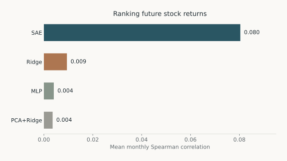
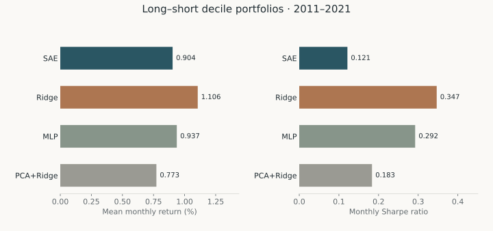

# Learning Latent Return Factors with a Supervised Autoencoder

Chau Nguyen · Purdue University · January–March 2026

## Research question
Can a compact representation of firm characteristics help predict and rank equity returns, and how does it compare with linear and neural baselines?

## Data and model
The monthly panel spans 2001–2021 and uses 94 firm characteristics. It contains 1,520,078 initial observations and 1,027,681 after excluding missing excess-return targets. Macroeconomic and industry columns are not model inputs. The merged CRSP/Compustat-derived panel is excluded from this public repository; see DATA_SETUP.md for the required schema.

The encoder maps 94 → 64 → 8 units, with ReLU and dropout 0.2. A linear head predicts excess returns; an 8 → 64 → 94 decoder reconstructs features. The objective combines return MSE, within-month pairwise ranking loss and reconstruction MSE with weights 0.5, 0.5 and 0.05. Comparisons use Ridge (alpha 5), PCA (8 components) plus Ridge, and an MLP (94 → 64 → 64 → 1).

For test year t, training ends at t−2 and validation uses t−1. Tests cover 2011–2021, or 132 months. SAE early stopping maximizes validation Rank IC; MLP selection uses validation MSE. The notebook filters unavailable targets before monthly median/zero imputation; its scaler is trained only on the training partition. The modular workflow imputes before target filtering, uses stable ranking loss and weighted validation batches, and reuses the evaluated encoder for interpretation.

## Results
The tables and figures below are aggregate results from the project notebook.

| Model | Mean Rank IC | Mean R² |
|---|---:|---:|
| Supervised autoencoder | 0.080381 | -0.036972 |
| Ridge | 0.009429 | -0.010766 |
| MLP | 0.004059 | -0.012341 |
| PCA + Ridge | 0.003583 | -0.008230 |




SAE leads Rank IC; Ridge leads the long–short decile return and monthly Sharpe comparison. Each month, portfolios buy the top 10% and sell the bottom 10% by predicted return, including threshold ties. Monthly Sharpe is not annualized; returns are gross of costs. Earlier notebook experiments also examine 80/20 quintiles. R² uses the test-year mean as its denominator benchmark.

Factor loadings approximate the product of the encoder's linear weight matrices.

## Run
```sh
python -m pip install -r requirements.txt
python run_notebook.py --data-dir /path/to/GatingModelData2 --output-dir artifacts/notebook
python analysis.py --data-dir /path/to/GatingModelData2 --output-dir artifacts/modular
python -m pytest -q
python plot.py --output-dir figures
```
The first command after installation executes `notebooks/supervised_autoencoder.ipynb`; the second runs the modular implementation. `supervised_autoencoder_analysis.ipynb` provides an interactive entry point for the modules. Results go to the requested output directory; model checkpoints and individual predictions are excluded from Git. The project notebook acknowledges coding assistance from ChatGPT.

[Portfolio case study](https://thesuncyrus.github.io/neural-network.html)
